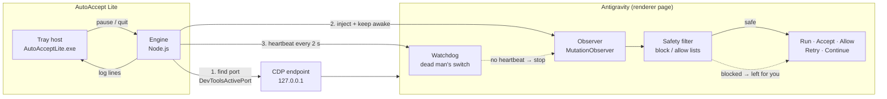

<div align="center">
  
  <h1>AutoAccept Lite</h1>
  <p><strong>A tiny Windows tray app that clicks Antigravity's approval buttons for you — no IDE, no extension, with a safety filter and a dead man's switch.</strong></p>

  <p>
    <strong>Language:</strong> <a href="README.md"><strong>EN</strong></a> | <a href="README.tr.md"><strong>TR</strong></a>
    &nbsp;•&nbsp;
    <a href="https://github.com/Hfatih/AutoAcceptLite/releases/latest">Download Release</a> ·
    <a href="#%EF%B8%8F-configuration">Configuration</a> ·
    <a href="#%EF%B8%8F-how-it-works">How It Works</a>
  </p>

  <p>
    
    
    
    
    
    
    
    
  </p>
  <p align="center">
    
    <a href="https://github.com/hfatih/AutoAcceptLite/releases"></a>
    <a href="https://github.com/hfatih/AutoAcceptLite/stargazers"></a>
    <a href="https://github.com/hfatih/AutoAcceptLite/forks"></a>
    <a href="https://github.com/hfatih/AutoAcceptLite/commits"></a>
  </p>
</div>

---

## 🚀 Overview

**AutoAccept Lite** watches the standalone **Antigravity** desktop app and presses its `Run`, `Accept`, `Always Allow`, `Retry` and `Continue` buttons the moment they appear, so long agent runs do not stall while you are away from the keyboard.

It lives in the Windows notification area, talks to Antigravity only over its own local Chrome DevTools Protocol endpoint on `127.0.0.1`, and installs nothing into Antigravity, VS Code or any extension host. Close the app and the page goes back to exactly how it was.

---

## 📸 Visual Tour

| **Live Log Window** |
| :---: |
|  |
| *The real log window, captured while the app ran against a demo page: clicks, and one command stopped by the safety filter.* |

---

## ✨ Key Features

### ⚡ Hands-Free Approvals
- **Clicks the buttons that block agent runs:** `Run`, `Accept`, `Always Allow`, `Allow this conversation`, `Allow`, `Retry`, `Continue`, plus any extra button texts you add.
- **Works while Antigravity is in the background:** Chromium throttles timers and stops rendering once a window is covered or minimized. The engine keeps the page awake, so approvals do not wait for you to bring the window back.
- **Follows several running conversations:** Antigravity only loads the selected conversation into the page. The engine cycles through conversations that are still running so each one gets its approvals.
- **Reconnects by itself:** start it before or after Antigravity; if Antigravity restarts, the engine finds the new port and carries on.

### 🛡️ Safety First
- **Command safety filter:** 52 destructive command patterns (`rm -rf /`, `format c:`, `git push --force`, `drop database`, piping into a shell, and more) are blocked by default. A blocked button is marked and left for you to decide.
- **Allow list:** optionally restrict auto-run to commands matching your own patterns. The block list always wins.
- **Dead man's switch:** the in-page observer needs a heartbeat from the engine every 2 seconds. If the engine dies, clicking stops within about 15 seconds and the observer removes itself.
- **Retry circuit breaker:** at most 3 `Retry` / `Continue` clicks per minute, so a failing step cannot loop forever.
- **Sidebar guard:** short words such as `run` in a conversation title are never mistaken for a button.

### 🪟 A Proper Tray App
- **Visible startup:** opens the log so you can see that it started. Close the log to leave it running in the notification area.
- **Show log:** a live view of connections, clicks and blocks.
- **Pause / Resume:** stop clicking without closing anything.
- **Restart engine:** apply `config.json` changes in one click.
- **Exit:** removes the observer from the page before closing.
- **Turkish and English:** the app and the installer follow the Windows display language.

### 🔒 100% Local & Zero Telemetry
- **Loopback only:** the single connection is to Antigravity's own CDP endpoint on `127.0.0.1`. It opens no debugging port of its own and never contacts another machine.
- **Nothing installed into Antigravity:** no extension, no patched files. Everything lives in the page's memory and disappears on exit.
- **No admin rights:** installs for the current user only, with Node.js bundled. It does not add itself to Windows startup.

---

## 🏗️ How It Works



1. **Discover.** When started with `--remote-debugging-port=0` (added to its shortcuts by the engine), Antigravity writes its debugging port to `%APPDATA%\Antigravity\DevToolsActivePort`. The engine reads it and verifies the endpoint.
2. **Inject.** For each renderer window it installs a watchdog and a `MutationObserver` that scans for matching buttons whenever the page changes.
3. **Filter and click.** Before pressing `Run`, the observer reads the command next to the button and checks it against the block and allow lists.
4. **Stay alive.** The engine refreshes a heartbeat, drains the click log into the tray, and keeps the page awake while Antigravity is hidden.

---

## 📥 Download and Installation

1. Download `AutoAcceptLite-Kurulum-<version>.exe` from the [Latest Release](https://github.com/Hfatih/AutoAcceptLite/releases/latest).
2. Run the installer. It installs for the current Windows user only and needs no administrator permission. Node.js is bundled.
3. Start **AutoAccept Lite** first; it adds the required flag to the Antigravity shortcuts. Then open **Antigravity** from its Start menu shortcut (if Antigravity is already running, quit it from the tray too and reopen it; see **1.1.8** below).
4. Look for the icon in the notification area (it may be behind the hidden-icons arrow). Hover over it to see the state.

Running a newer installer over an existing installation upgrades it and keeps your `config.json`.

**Portable:** download `AutoAcceptLite-Portable-1.1.10.zip`, extract the **entire** ZIP to a folder, then run `AutoAcceptLite.exe` inside it. Keep `app/` and `runtime/` next to the EXE. No separate Node.js installation is needed. A launcher EXE downloaded alone cannot work without these folders.

**1.1.10 — faster approvals.** When the approval bar opened a new Submit/Run/Allow button in the same place, each one waited about 5 seconds: the post-click wait was tied to the button's position, not the button. The 5 s wait now applies only to the button that was clicked; a new button in the same place is clicked within about 0.6 s (measured 10–69 ms in Antigravity).

**1.1.9 — safer shortcut handling.** The flag below is now added only to **your own** Start menu, desktop and taskbar shortcuts; shortcuts shared by all Windows users are never touched, so the debugging port is not opened for other accounts. Uninstalling AutoAccept Lite takes `--remote-debugging-port=0` back out of those shortcuts and leaves Antigravity as it was. A port you set yourself (for example `--remote-debugging-port=9222`) is kept.

**1.1.8 — Antigravity 44.9.1 connection fix.** After the Antigravity 44.9.1 update, AutoAccept Lite could no longer find Antigravity. Antigravity used to open its debugging (CDP) port by itself, and AutoAccept Lite clicks the buttons through that port. Since 44.9.1 the port opens only when Antigravity is started with `--remote-debugging-port`. **What we did:** on every start AutoAccept Lite adds `--remote-debugging-port=0` to your Antigravity Start menu, desktop and taskbar shortcuts (`0` lets Antigravity pick a free local port, bound to `127.0.0.1` only), and the log tells you when Antigravity was started without it. **What you do:** install the latest version and start it once, fully quit Antigravity (tray included), then reopen Antigravity **from the Start menu shortcut**. When the log shows `Connected: 127.0.0.1:…`, you are done. If you launch Antigravity some other way, add the same flag: `"%LOCALAPPDATA%\Programs\Antigravity\Antigravity.exe" --remote-debugging-port=0`. When Antigravity auto-updates it restarts without the flag; the log then warns "debug port is closed", and reopening Antigravity from the shortcut once fixes it.

**1.1.7:** stops endless Retry clicking on pages where Retry reloads the page (e.g. Android CLI plugin panels showing "The Android CLI is not installed"). The 3-per-minute circuit breaker now lives in the engine per window, so a reload no longer resets it; after 3 Retry/Continue clicks in 60 s that window is paused for 10 minutes and the log says so.

**1.1.6:** tightens the 1.1.5 filter change: every code block in the button's own card is checked again (not only the nearest one); outside the card, all adjacent blocks before the button are checked together; an extraction error now blocks the click instead of allowing it.

**1.1.5:** fixes false `Blocked by Filter` on Allow/Accept buttons: only the code block right next to the button is checked, so example code in earlier messages no longer blocks them. Retry/Continue are no longer filtered (they run no command). The log now shows which pattern blocked which command. `Run` is still always checked against its nearest command.

**1.1.4:** fixes an engine crash on CDP connection timeout; opens the log at startup and after an unexpected engine failure; saves the last session for troubleshooting; adds a complete portable package and `SHA256SUMS.txt`. The installer no longer lists unrelated `node.exe` processes in its close-applications filter. Bundled runtime: official Node.js 22.23.4 x64.

> [!NOTE]
> The project EXEs are **unsigned**. SmartScreen reputation warnings and Smart App Control blocks may still occur; rebuilding or using the portable ZIP does not guarantee approval. See [Microsoft's explanation](https://learn.microsoft.com/en-us/windows/apps/develop/smart-app-control/overview). No trusted code-signing certificate was available for this release. The installer does not change Windows security settings or add antivirus exclusions.
>
> A named antivirus detection or quarantine entry needs investigation using its exact threat name and file hash. This release is not advertised as antivirus-certified or as a confirmed false-positive fix. SHA-256 verifies file integrity, not safety.

Task Manager shows the app as two rows: **AutoAccept Lite** (tray host) and **Node.js JavaScript Runtime** (engine).

---

## ⚙️ Configuration

Settings live in `%LOCALAPPDATA%\Programs\AutoAcceptLite\app\config.json`. After editing, choose **Restart engine** from the tray menu.

| Key | Default | What it does |
| :--- | :--- | :--- |
| `autoAcceptFileEdits` | `true` | Click `Accept` on file edits. Set `false` to review edits yourself. |
| `autoRetryEnabled` | `true` | Click `Retry` and `Continue`. |
| `customButtonTexts` | `["submit"]` | Extra button texts to click, for example localized labels. |
| `useSafetyPresets` | `true` | Apply the built-in list of destructive command patterns. |
| `blockedCommands` | `[]` | Your own patterns that must never be auto-run. |
| `allowedCommands` | `[]` | If not empty, only commands matching these patterns are auto-run. |
| `keepActiveInBackground` | `true` | Keep the page awake while Antigravity is covered or minimized. |
| `autoCycleActiveConversations` | `true` | Cycle through conversations that are still running. |
| `conversationSwitchMs` | `1500` | Minimum time between conversation switches (500–30000). |
| `heartbeatMs` | `2000` | Scan and heartbeat interval (minimum 1000). |
| `maxConcurrentTargets` | `12` | Windows handled in parallel (1–64). |
| `language` | `"auto"` | `"auto"` follows Windows; `"tr"` or `"en"` forces one. |
| `port` | `null` | CDP port. `null` finds it automatically. |
| `verbose` | `false` | Log per-target errors for troubleshooting. |

---

## ⚠️ Safety Notes

- The safety filter is a guard rail, not a sandbox. If the command text next to a button cannot be read, a risky command may not be recognized.
- `customButtonTexts` contains `submit` by default. That can submit an empty answer and continue without your input; remove it if you do not want that.
- `keepActiveInBackground` makes Antigravity keep rendering while hidden, which uses some extra CPU/GPU.
- Review the defaults and pick settings that match how much you trust the agent with your machine.

---

## 🔨 Building from Source

### Prerequisites
- Windows 10/11 (x64)
- [Node.js](https://nodejs.org/) 22 or a compatible current release
- .NET Framework 4.x (ships with Windows) for the tray host
- [Inno Setup](https://jrsoftware.org/isinfo.php) 6 or later for the installer

### Development Mode
```powershell
# Clone the repository
git clone https://github.com/Hfatih/AutoAcceptLite.git
cd AutoAcceptLite

# Install the single dependency (ws)
npm ci

# Run the engine in a terminal: P pauses/resumes, Ctrl+C exits
npm start
```

### Windows Installer
```powershell
powershell -ExecutionPolicy Bypass -File packaging/windows/build.ps1
```
The installer is written to `packaging/windows/dist/`. See [`packaging/windows/README.md`](packaging/windows/README.md) for the runtime files the build expects.

### Running Tests
```powershell
npm test
```

---

## 🩺 Troubleshooting

- **"Antigravity not found" in the log:** open Antigravity; the engine connects on its own. If you set `port` manually, make sure it is the right one.
- **"debug port is closed" in the log:** since Antigravity 44.9.1 the app opens its debugging port only when started with `--remote-debugging-port`. AutoAccept Lite adds `--remote-debugging-port=0` to the Antigravity shortcuts on every start; fully quit Antigravity (tray included) and reopen it from the Start menu. After an Antigravity auto-update restarts the app, reopen it from the shortcut once more.
- **The icon is there but nothing is clicked:** hover over the icon. *paused* means choose **Resume**; *engine stopped* means choose **Restart engine** and check the log.
- **Nothing happens when the shortcut is clicked:** the log should open on startup. If it does not, check Windows Security's Protection history for a block or quarantine entry and record the exact message. If already running, look behind the hidden-icons arrow.
- **Missing application files:** reinstall the complete installer or extract the entire portable ZIP. Do not run the EXE from inside the ZIP.
- **Diagnostics:** choose **Open log folder** from the tray menu. Logs are in `%LOCALAPPDATA%\AutoAcceptLite\logs`: `last-session.log` (last 1,000 lines, overwritten on exit/failure) and `launcher-error.log` (startup exceptions). For a package check without starting approvals, run `.\AutoAcceptLite.exe --check` and inspect its exit code (0 = modules loaded successfully).
- **A command you expected was not run:** it probably matched the safety filter. The log shows a `BLOCKED` line and the button is marked in the page.

---

## 📄 License & Disclaimer

Released under the [GNU GPL v3.0](LICENSE). `src/DOMObserver.js` is based on the MIT-licensed [AntiGravity-AutoAccept](https://github.com/yazanbaker94/AntiGravity-AutoAccept) project; its copyright and license notice are preserved in [`LICENSE.upstream`](LICENSE.upstream). The bundled Node.js runtime is covered by its own terms, shipped as `LICENSE.node.txt`. See also [third-party notices](THIRD-PARTY-NOTICES.md).

*AutoAccept Lite is an independent open-source project and is not affiliated with Google. Antigravity and other named products are trademarks of their respective owners. Automatically approving agent actions is done at your own risk.*

Project-owned code and original material in this revision are licensed under [GNU GPL v3.0](LICENSE) (GPL-3.0-only). Third-party code, fonts, imagery, data, and brand assets retain their own terms and attributions. [Previous license and copyright notice](licenses/previous-license.txt).
