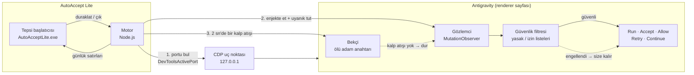

<div align="center">
  
  <h1>AutoAccept Lite</h1>
  <p><strong>Antigravity'nin onay düğmelerine sizin yerinize basan küçük bir Windows tepsi uygulaması — IDE ve eklenti gerektirmez; güvenlik filtresi ve ölü adam anahtarı içerir.</strong></p>

  <p>
    <strong>Dil:</strong> <a href="README.md"><strong>EN</strong></a> | <a href="README.tr.md"><strong>TR</strong></a>
    &nbsp;•&nbsp;
    <a href="https://github.com/Hfatih/AutoAcceptLite/releases/latest">Sürümü İndir</a> ·
    <a href="#%EF%B8%8F-ayarlar">Ayarlar</a> ·
    <a href="#%EF%B8%8F-nasıl-çalışır">Nasıl Çalışır</a>
  </p>

  <p>
    
    
    
    
    
    
    
    
  </p>
  <p align="center">
    
    <a href="https://github.com/hfatih/AutoAcceptLite/releases"></a>
    <a href="https://github.com/hfatih/AutoAcceptLite/stargazers"></a>
    <a href="https://github.com/hfatih/AutoAcceptLite/forks"></a>
    <a href="https://github.com/hfatih/AutoAcceptLite/commits"></a>
  </p>
</div>

---

## 🚀 Genel Bakış

**AutoAccept Lite**, bağımsız **Antigravity** masaüstü uygulamasını izler ve `Run`, `Accept`, `Always Allow`, `Retry` ve `Continue` düğmelerine göründükleri anda basar; böylece uzun ajan çalışmaları siz klavyenin başında değilken takılıp kalmaz.

Windows bildirim alanında yaşar, Antigravity ile yalnızca onun kendi yerel Chrome DevTools Protocol uç noktası üzerinden (`127.0.0.1`) konuşur ve Antigravity'ye, VS Code'a ya da herhangi bir eklentiye hiçbir şey kurmaz. Uygulamayı kapattığınızda sayfa eski haline döner.

---

## 📸 Görsel Tur

| **Canlı Günlük Penceresi** |
| :---: |
|  |
| *Gerçek günlük penceresi; uygulama bir deneme sayfasına karşı çalışırken çekildi: tıklamalar ve güvenlik filtresine takılan bir komut. Görüntü İngilizce arayüzdendir; Türkçe Windows'ta arayüz Türkçe açılır.* |

---

## ✨ Öne Çıkan Özellikler

### ⚡ Elleriniz Serbest
- **Ajanı bekleten düğmelere basar:** `Run`, `Accept`, `Always Allow`, `Allow this conversation`, `Allow`, `Retry`, `Continue` ve sizin eklediğiniz özel düğme metinleri.
- **Antigravity arka plandayken de çalışır:** Chromium, pencere örtüldüğünde ya da küçültüldüğünde zamanlayıcıları kısar ve çizimi durdurur. Motor sayfayı uyanık tutar; onaylar pencereyi öne almanızı beklemez.
- **Birden fazla çalışan sohbeti izler:** Antigravity yalnızca seçili sohbeti sayfaya yükler. Motor hâlâ çalışan sohbetler arasında dolaşır, her biri kendi onayını alır.
- **Kendiliğinden yeniden bağlanır:** Antigravity'den önce ya da sonra başlatabilirsiniz; Antigravity yeniden açılırsa motor yeni portu bulup devam eder.

### 🛡️ Önce Güvenlik
- **Komut güvenlik filtresi:** 52 yıkıcı komut kalıbı (`rm -rf /`, `format c:`, `git push --force`, `drop database`, kabuğa boruyla aktarma ve benzerleri) varsayılan olarak engellenir. Engellenen düğme işaretlenir ve karar size bırakılır.
- **İzin listesi:** isterseniz otomatik çalıştırmayı yalnızca kendi kalıplarınıza uyan komutlarla sınırlayabilirsiniz. Yasak listesi her zaman önceliklidir.
- **Ölü adam anahtarı:** sayfadaki gözlemci, motordan 2 saniyede bir kalp atışı bekler. Motor ölürse tıklama yaklaşık 15 saniye içinde durur ve gözlemci kendini kaldırır.
- **Yeniden deneme sigortası:** dakikada en fazla 3 `Retry` / `Continue` tıklaması yapılır; başarısız bir adım sonsuz döngüye giremez.
- **Kenar çubuğu koruması:** sohbet başlığında geçen `run` gibi kısa sözcükler düğme sanılmaz.

### 🪟 Düzgün Bir Tepsi Uygulaması
- **Görünür başlangıç:** açıldığını görebilmeniz için günlük penceresini açar. Pencereyi kapatınca bildirim alanında çalışmayı sürdürür.
- **Günlüğü göster:** bağlantıları, tıklamaları ve engellemeleri canlı izleyin.
- **Duraklat / Devam et:** hiçbir şeyi kapatmadan tıklamayı durdurun.
- **Motoru yeniden başlat:** `config.json` değişikliklerini tek tıkla uygulayın.
- **Çıkış:** kapanmadan önce gözlemciyi sayfadan kaldırır.
- **Türkçe ve İngilizce:** uygulama ve kurulum sihirbazı Windows görüntüleme diline uyar.

### 🔒 %100 Yerel & Telemetri Yok
- **Yalnızca yerel bağlantı:** tek bağlantı Antigravity'nin `127.0.0.1` üzerindeki kendi CDP uç noktasınadır. Kendi hata ayıklama portunu açmaz, başka bir makineye bağlanmaz.
- **Antigravity'ye hiçbir şey kurulmaz:** eklenti yok, değiştirilen dosya yok. Her şey sayfanın belleğinde yaşar ve çıkışta kaybolur.
- **Yönetici izni gerekmez:** yalnızca geçerli kullanıcıya kurulur, Node.js pakete dahildir. Windows açılışına kendini eklemez.

---

## 🏗️ Nasıl Çalışır



1. **Bul.** `--remote-debugging-port=0` ile açılan Antigravity (motor bu bayrağı kısayollarına ekler) hata ayıklama portunu `%APPDATA%\Antigravity\DevToolsActivePort` dosyasına yazar. Motor bunu okur ve uç noktayı doğrular.
2. **Enjekte et.** Her renderer penceresine bir bekçi ve sayfa değiştikçe eşleşen düğmeleri tarayan bir `MutationObserver` kurar.
3. **Süz ve tıkla.** Gözlemci `Run` düğmesine basmadan önce yanındaki komutu okur, yasak ve izin listeleriyle karşılaştırır.
4. **Canlı tut.** Motor kalp atışını tazeler, tıklama kaydını tepsiye aktarır ve Antigravity gizliyken sayfayı uyanık tutar.

---

## 📥 İndirme ve Kurulum

1. [Son Sürüm](https://github.com/Hfatih/AutoAcceptLite/releases/latest) sayfasından `AutoAcceptLite-Kurulum-<sürüm>.exe` dosyasını indirin.
2. Kurulumu çalıştırın. Yalnızca geçerli Windows kullanıcısına kurulur, yönetici izni istemez. Node.js pakete dahildir.
3. Önce **AutoAccept Lite**'ı başlatın; Antigravity kısayollarına gereken bayrağı ekler. Sonra **Antigravity**'yi Başlat menüsündeki kısayolundan açın (Antigravity zaten açıksa tepsiden de kapatıp yeniden açın, ayrıntı aşağıda 1.1.8 bölümünde).
4. Bildirim alanındaki simgeyi bulun (gizli simgeler okunun arkasında olabilir). Fareyi üzerine getirince durumu görürsünüz.

Yeni kurulum dosyasını mevcut kurulumun üzerine çalıştırmak uygulamayı günceller ve `config.json` dosyanızı korur.

> [!NOTE]
> Dosyalar güvenilir yayıncı sertifikasıyla imzalanmamıştır; Windows SmartScreen ya da Smart App Control uyarı verebilir veya engelleyebilir. Kurulum, Windows güvenlik ayarlarını hiçbir zaman değiştirmez.

Görev Yöneticisi'nde uygulama iki satır olarak görünür: **AutoAccept Lite** (tepsi başlatıcısı) ve **Node.js JavaScript Runtime** (motor).

---

## 🔒 1.1.9: daha güvenli kısayol ayarı

- Bayrak artık yalnız **sizin** Başlat menüsü, masaüstü ve görev çubuğu kısayollarınıza eklenir. Tüm Windows kullanıcılarının ortak kısayollarına dokunulmaz; hata ayıklama portu başka hesaplar için açılmaz.
- AutoAccept Lite kaldırılınca `--remote-debugging-port=0` bu kısayollardan geri alınır, Antigravity eski haline döner.
- Kendi verdiğiniz bir port (ör. `--remote-debugging-port=9222`) korunur.

## 🔌 1.1.8: Antigravity 44.9.1 bağlantı düzeltmesi

**Ne oldu:** Antigravity 44.9.1 güncellemesinden sonra AutoAccept Lite Antigravity'yi bulamaz oldu. Antigravity eskiden hata ayıklama (CDP) portunu kendiliğinden açıyordu ve AutoAccept Lite düğmelere bu porttan basıyordu. 44.9.1 ile bu port artık yalnız Antigravity `--remote-debugging-port` ayarıyla başlatılırsa açılıyor.

**Ne yaptık:** AutoAccept Lite her açılışta sizin Antigravity Başlat menüsü, masaüstü ve görev çubuğu kısayollarınıza `--remote-debugging-port=0` ekler. `0`, Antigravity'nin boş bir yerel port seçmesi demektir; port yalnız `127.0.0.1` üzerinde açılır. Antigravity ayarsız açılmışsa günlük bunu söyler ve ne yapmanız gerektiğini yazar.

**Siz ne yapacaksınız:**
1. AutoAccept Lite'ın son sürümünü kurun ve bir kez başlatın; kısayollar güncellenir.
2. Antigravity'yi tepsideki simgesi dahil tamamen kapatın.
3. Antigravity'yi **Başlat menüsündeki kısayoldan** açın. Günlükte `Bağlandı: 127.0.0.1:…` satırını görünce iş tamamdır.

Kendi kısayolunuzu kullanıyorsanız ya da Antigravity'yi elle başlatıyorsanız aynı ayarı ekleyin:

```text
"%LOCALAPPDATA%\Programs\Antigravity\Antigravity.exe" --remote-debugging-port=0
```

> [!IMPORTANT]
> Antigravity kendini otomatik güncellediğinde ayarsız yeniden açılır. Böyle olursa günlükte "hata ayıklama portu kapalı" uyarısı çıkar; Antigravity'yi bir kez kapatıp kısayoldan açmanız yeterli.

## 🔁 1.1.7: Retry döngüsü düzeltmesi

- Retry sayfayı yeniden yüklüyorsa (ör. "The Android CLI is not installed" diyen Android CLI eklenti panelleri) artık 2 saniyede bir basılmaz.
- Dakikada 3 deneme sınırı sayfa yerine motorda, pencere başına tutulur; yeniden yükleme sayacı sıfırlamaz.
- 60 sn içinde 3 Retry/Continue olursa o pencerede 10 dakika basılmaz; günlük bunu yazar.

## 🛡️ 1.1.6: filtre sıkılaştırması

- Düğmenin kendi kartındaki tüm kod blokları yeniden denetlenir (yalnız en yakını değil).
- Kart dışında, düğmeden önceki bitişik blokların hepsi birlikte denetlenir.
- Komut okunurken hata olursa düğmeye basılmaz.

## 🛡️ 1.1.5: yanlış "Blocked by Filter" düzeltmesi

- Allow/Accept düğmelerinde yalnız düğmenin hemen yanındaki kod bloğu denetlenir; önceki mesajlardaki örnek kodlar (`sudo su`, `drop table`...) artık onları kilitlemez.
- Retry/Continue artık filtreye girmez (komut çalıştırmazlar).
- Günlük, hangi kalıbın hangi komutu engellediğini yazar.
- `Run` her zaman en yakın komutla denetlenmeye devam eder.

## 📦 1.1.4 sürümü ve taşınabilir paket

- CDP bağlantısı zaman aşımına uğradığında motoru düşüren hata düzeltildi.
- Günlük başlangıçta ve beklenmeyen motor hatasında görünür; son oturum diske kaydedilir.
- Kurulumun uygulama kapatma filtresinden genel `node.exe` adı çıkarıldı.
- Resmi Node.js 22.23.4 x64 içeren eksiksiz taşınabilir ZIP ve `SHA256SUMS.txt` eklendi.

**Taşınabilir kullanım:** son sürümden `AutoAcceptLite-Portable-1.1.7.zip` dosyasını indirin, **tamamını** bir klasöre çıkarın ve içindeki `AutoAcceptLite.exe` dosyasını çalıştırın. `app/` ve `runtime/` klasörleri EXE'nin yanında kalmalıdır. ZIP'in içinden veya tek başına indirilen launcher EXE ile çalıştırmayın. Ayrıca Node.js kurmanız gerekmez.

**Günlükler:** tepsi menüsündeki **Günlük klasörünü aç** seçeneğini kullanın. `%LOCALAPPDATA%\AutoAcceptLite\logs` altında `last-session.log` son 1.000 satırı (çıkışta/hata durumunda üzerine yazılır), `launcher-error.log` başlangıç hatalarını tutar. Onay motorunu başlatmadan paket kontrolü için `.\AutoAcceptLite.exe --check` çalıştırın; çıkış kodu 0, modüllerin yüklendiğini gösterir.

**Güvenlik uyarıları:** proje EXE'leri **imzasızdır**; bu sürüm için güvenilir kod imzalama sertifikası mevcut değildi. SmartScreen uyarısı veya Smart App Control engeli devam edebilir; yeniden derleme ve taşınabilir ZIP bunu kesin çözmez. [Microsoft'un açıklaması](https://learn.microsoft.com/en-us/windows/apps/develop/smart-app-control/overview). Güvenlik ayarları değiştirilmez ve antivirüs istisnası eklenmez. Karantina/tehdit uyarısı varsa tam tehdit adı ve dosya özetiyle ayrıca incelenmelidir. Bu sürüm için "antivirüs onaylı" veya "kesin yanlış alarm düzeltildi" iddiası yoktur. SHA-256, dosya bütünlüğünü doğrular; güvenli olduğunu kanıtlamaz.

## ⚙️ Ayarlar

Ayarlar `%LOCALAPPDATA%\Programs\AutoAcceptLite\app\config.json` dosyasındadır. Düzenledikten sonra tepsi menüsünden **Motoru yeniden başlat**'ı seçin.

| Anahtar | Varsayılan | Ne yapar |
| :--- | :--- | :--- |
| `autoAcceptFileEdits` | `true` | Dosya düzenlemelerinde `Accept`'e basar. Düzenlemeleri kendiniz incelemek için `false` yapın. |
| `autoRetryEnabled` | `true` | `Retry` ve `Continue` düğmelerine basar. |
| `customButtonTexts` | `["submit"]` | Basılacak ek düğme metinleri, örneğin yerelleştirilmiş etiketler. |
| `useSafetyPresets` | `true` | Hazır yıkıcı komut kalıpları listesini uygular. |
| `blockedCommands` | `[]` | Asla otomatik çalıştırılmayacak kendi kalıplarınız. |
| `allowedCommands` | `[]` | Boş değilse yalnızca bu kalıplara uyan komutlar otomatik çalışır. |
| `keepActiveInBackground` | `true` | Antigravity örtülüyken ya da küçültülmüşken sayfayı uyanık tutar. |
| `autoCycleActiveConversations` | `true` | Hâlâ çalışan sohbetler arasında dolaşır. |
| `conversationSwitchMs` | `1500` | İki sohbet geçişi arasındaki en kısa süre (500–30000). |
| `heartbeatMs` | `2000` | Tarama ve kalp atışı aralığı (en az 1000). |
| `maxConcurrentTargets` | `12` | Aynı anda işlenen pencere sayısı (1–64). |
| `language` | `"auto"` | `"auto"` Windows'u izler; `"tr"` ya da `"en"` dili sabitler. |
| `port` | `null` | CDP portu. `null` otomatik bulur. |
| `verbose` | `false` | Sorun gidermek için hedef başına hataları günlüğe yazar. |

---

## ⚠️ Güvenlik Notları

- Güvenlik filtresi bir korkuluktur, karantina değildir. Düğmenin yanındaki komut metni okunamazsa riskli bir komut tanınmayabilir.
- `customButtonTexts` varsayılan olarak `submit` içerir. Bu, boş bir yanıtı gönderip siz yazmadan devam edebilir; istemiyorsanız kaldırın.
- `keepActiveInBackground`, Antigravity'nin gizliyken de çizim yapmasına yol açar; bu biraz daha fazla CPU/GPU kullanır.
- Varsayılanları gözden geçirin ve ajana bilgisayarınızda ne kadar güvendiğinize uygun ayarları seçin.

---

## 🔨 Kaynaktan Derleme

### Gereksinimler
- Windows 10/11 (x64)
- [Node.js](https://nodejs.org/) 22 ya da uyumlu güncel bir sürüm
- Tepsi başlatıcısı için .NET Framework 4.x (Windows ile gelir)
- Kurulum dosyası için [Inno Setup](https://jrsoftware.org/isinfo.php) 6 veya üstü

### Geliştirme Modu
```powershell
# Depoyu klonlayın
git clone https://github.com/Hfatih/AutoAcceptLite.git
cd AutoAcceptLite

# Tek bağımlılığı (ws) kurun
npm ci

# Motoru terminalde çalıştırın: P duraklatır/devam ettirir, Ctrl+C çıkar
npm start
```

### Windows Kurulum Dosyası
```powershell
powershell -ExecutionPolicy Bypass -File packaging/windows/build.ps1
```
Kurulum dosyası `packaging/windows/dist/` klasörüne yazılır. Derlemenin beklediği çalışma zamanı dosyaları için [`packaging/windows/README.md`](packaging/windows/README.md) dosyasına bakın.

### Testleri Çalıştırma
```powershell
npm test
```

---

## 🩺 Sorun Giderme

- **Günlükte "Antigravity bulunamadı":** Antigravity'yi açın; motor kendiliğinden bağlanır. `port` değerini elle verdiyseniz doğru olduğundan emin olun.
- **Günlükte "hata ayıklama portu kapalı":** Antigravity 44.9.1'den beri portu yalnız `--remote-debugging-port` ile başlatılınca açıyor. AutoAccept Lite her açılışta Antigravity kısayollarına `--remote-debugging-port=0` ekler; Antigravity'yi tepsiden de tamamen kapatıp Başlat menüsünden açın. Antigravity'nin otomatik güncellemesi uygulamayı yeniden başlatırsa bir kez daha kısayoldan açın.
- **Simge duruyor ama hiçbir şeye basılmıyor:** fareyi simgenin üzerine getirin. *duraklatıldı* ise **Devam et**'i, *motor durdu* ise **Motoru yeniden başlat**'ı seçip günlüğe bakın.
- **Kısayola tıklayınca hiçbir şey olmuyor:** başlangıçta günlük penceresi açılmalıdır. Açılmıyorsa Windows Güvenliği'nin Koruma geçmişinde engel/karantina kaydı olup olmadığına bakın ve tam uyarı metnini kaydedin. Uygulama zaten çalışıyorsa gizli simgeler okunun arkasına bakın.
- **Uygulama dosyaları eksik:** tam kurulum paketini yeniden kurun veya taşınabilir ZIP'in tamamını çıkarın; tek başına launcher EXE yeterli değildir.
- **Beklediğiniz bir komut çalıştırılmadı:** büyük olasılıkla güvenlik filtresine takıldı. Günlükte `ENGELLENDİ` satırı görünür ve düğme sayfada işaretlenir.

---

## 📄 Lisans & Sorumluluk Reddi

[MIT Lisansı](LICENSE) ile yayınlanır. `src/DOMObserver.js`, MIT lisanslı [AntiGravity-AutoAccept](https://github.com/yazanbaker94/AntiGravity-AutoAccept) projesine dayanır; özgün telif ve lisans bildirimi [`LICENSE.upstream`](LICENSE.upstream) içinde korunur. Pakete dahil Node.js çalışma zamanı kendi koşullarına tabidir ve `LICENSE.node.txt` olarak gelir. Ayrıca [üçüncü taraf bildirimlerine](THIRD-PARTY-NOTICES.md) bakın.

*AutoAccept Lite bağımsız bir açık kaynak projedir ve Google ile bağlantılı değildir. Antigravity ve adı geçen diğer ürünler ilgili sahiplerinin ticari markalarıdır. Ajan eylemlerini otomatik onaylamanın sorumluluğu size aittir.*
